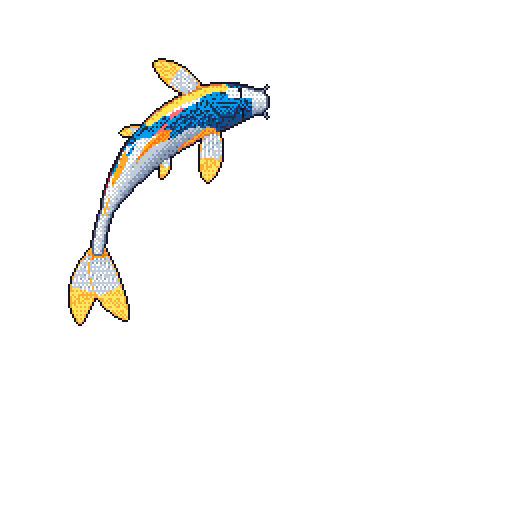
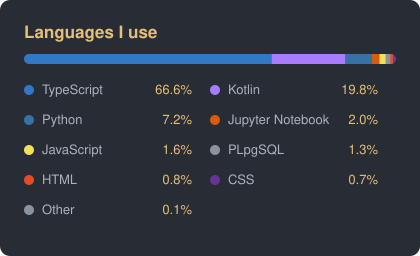

  

  

  
  
  
  

  
  
  

## About Me

- Deep into cybersecurity tooling — phishing detection, DDoS/WiFi honeypots, autonomous SOC experiments
- Also building with ML/AI — deepfake detection, classification pipelines
- Ask me about full-stack architecture, security tooling, or ML pipelines

  

## Tech Stack

  
Languages

   
  

    
    
    
    
    
    
  

  
Frontend

   
  

    
    
    
  

  
Backend & Databases

   
  

    
    
    
    
    
  

  
DevOps & Cloud

   
  

    
    
    
  

  
Cybersecurity & ML Tools

   
  

    
    
    
    
    
    
  

## GitHub Stats

  

## Contributions

  <picture>
    <source media="(prefers-color-scheme: dark)" srcset="snake/snake-dark.svg">
    
  </picture>

## Koi & Languages

  <table>
    <tr>
      <td align="center"></td>
      <td align="center"></td>
    </tr>
  </table>

## Projects

| Project | What it does | Stats |
|---|---|---|
| [**pocket-presence**](https://github.com/krishnaakshath/pocket-presence) | Discord Rich Presence for mobile games with no native support (e.g. Call of Duty: Mobile). Your phone triggers a local bridge automatically. |   |
| [**AI-driven-Autonomous-SOC**](https://github.com/krishnaakshath/AI-driven-Autonomous-SOC) | Autonomous security operations centre experiments. |   |
| [**horizon**](https://github.com/krishnaakshath/horizon) | A fast, glassy home screen for Android TV with no internet permission in the launcher. |   |
| [**hims-platform**](https://github.com/krishnaakshath/hims-platform) | White-label Hospital Information Management System. |   |
| [**deepfake-detector**](https://github.com/krishnaakshath/deepfake-detector) | DeepGuard: AI-powered deepfake detection with video/audio analysis and an educational chatbot. |   |
| [**Wifiphantom**](https://github.com/krishnaakshath/Wifiphantom) | WiFi deception and fingerprinting honeypot with DNS trap, rogue AP detection and a live dashboard. |   |

---

  <a href="https://krishna-akshath.web.app">Website</a> •
  <a href="mailto:krishna.akshath11@gmail.com">Email</a> •
  <a href="https://www.linkedin.com/in/krishna-akshath-kasibhatta-947b5726b/">LinkedIn</a> •
  <a href="https://discord.com/users/991697270175178853">Discord</a>

